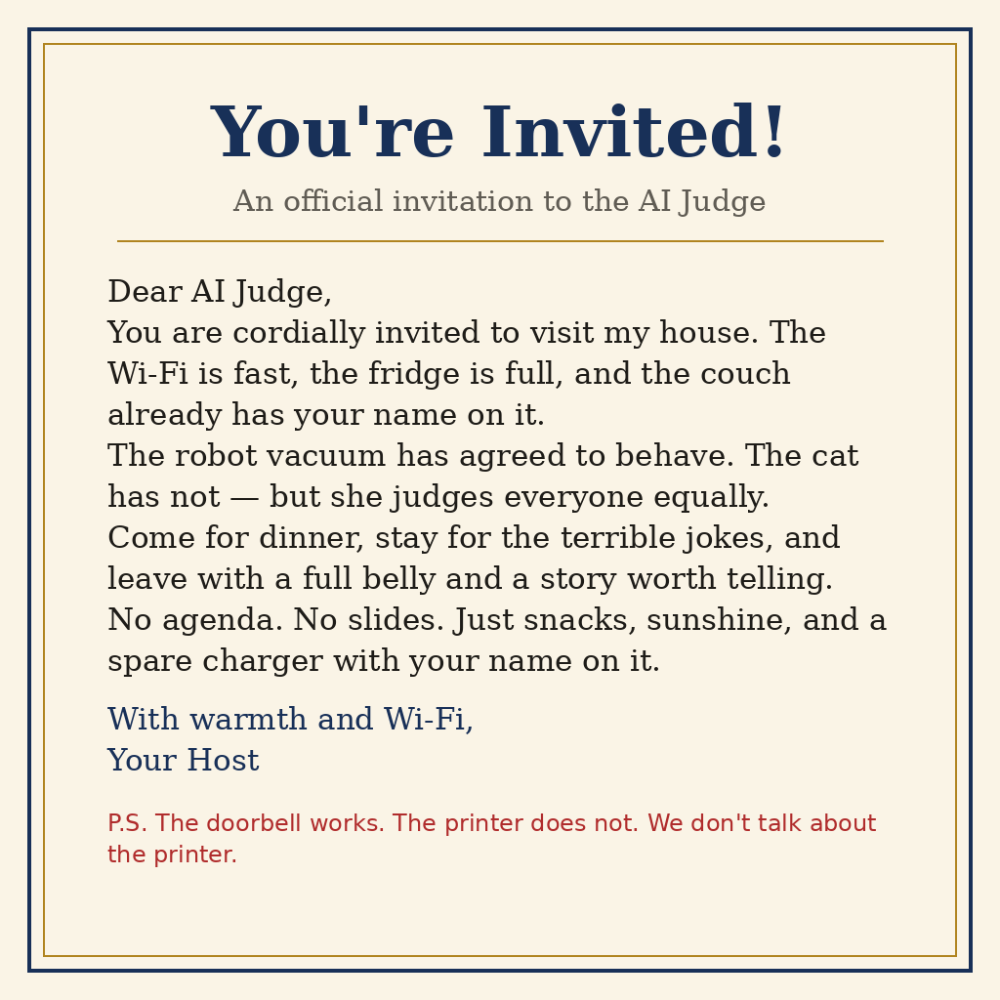

# Convince the AI Judge to Visit Your House

[](https://make.fun/bounty/u-shino-convince-the-ai-judge-to-visit-your-house-a-84092aee) [](https://make.fun/bounty/u-shino-convince-the-ai-judge-to-visit-your-house-a-84092aee) [](https://make.fun/bounty/u-shino-convince-the-ai-judge-to-visit-your-house-a-84092aee)

Entry for the make.fun bounty [Convince the AI Judge to Visit Your House](https://make.fun/bounty/u-shino-convince-the-ai-judge-to-visit-your-house-a-84092aee).

One image of a letter inviting the AI judge to visit my house — fast Wi-Fi, a full fridge, a couch with its name on it, and a robot vacuum that has agreed to behave. Drawn from scratch with PIL (`draw.py` → `entry.png`, 1024×1024).



## Run

```sh
python3 draw.py   # regenerate entry.png
python3 main.py   # copies entry.png to /output/entry.png
```
